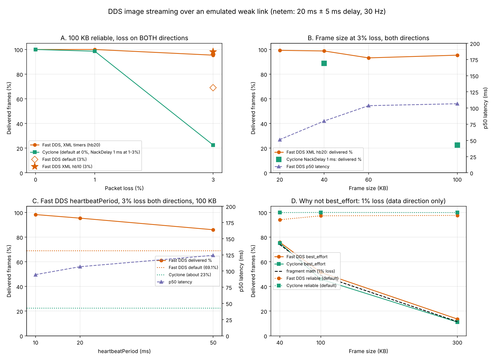

# DDS image-streaming benchmark

Which DDS (Fast DDS or Cyclone DDS), which QoS and which settings deliver camera images best over a weak, lossy wireless link? This repo holds the test rig, the configurations we tried, the raw results and the conclusions.

The target is a rover sending camera images to a base station about 550 m away. The link is emulated on one PC with two Docker containers and `tc netem` (20 ms delay, 5 ms jitter, 0 to 5% packet loss), using ROS 2 Jazzy.

## Result in brief

- **Use Fast DDS (`rmw_fastrtps_cpp`) with reliable QoS** and the timing profile in [`recommended/fd-rover.xml`](recommended/fd-rover.xml).
- **Keep images at about 40 KB or less.** With 3% loss in both directions, 40 KB images arrive 98.8% of the time (median delay 80 ms). 100 KB gives about 95 to 98%. 300 KB is not workable (about 41%).
- **Do not use best_effort** for images above about 40 KB. Delivery follows the fragment math: at 1% loss only about half of 100 KB images and 11% of 300 KB images arrive, with either DDS.
- **Set four Linux kernel settings** on both machines ([`recommended/99-dds-tuning.conf`](recommended/99-dds-tuning.conf)). In particular `net.ipv4.ipfrag_max_dist=0`: with the default (64), Linux silently drops large images whose packets arrive out of order, which jitter causes.
- Cyclone DDS looked better while the return path was clean, but collapsed (about 23% delivered at 3% loss, 100 KB) once acknowledgements were also lossy and delayed. We could not find a setting that fixes this.

Full write-up with plain-language explanations: see [`docs/`](docs/). Plots:



## Recommended configuration

```bash
export RMW_IMPLEMENTATION=rmw_fastrtps_cpp
export RMW_FASTRTPS_USE_QOS_FROM_XML=1
export FASTDDS_DEFAULT_PROFILES_FILE=/path/to/fd-rover.xml
```

Use reliable QoS (history depth 5 was tested). Install `recommended/99-dds-tuning.conf` as `/etc/sysctl.d/99-dds-tuning.conf` on both machines and run `sudo sysctl --system`.

## Reproduce the tests

Requirements: Ubuntu, Docker with the compose plugin, `sudo`.

```bash
git clone https://github.com/Mohamed-Z-Ali/dds-bench.git
cd dds-bench

# Host-wide setting; Docker refuses to set it per container
sudo sysctl -w net.core.rmem_max=268435456

export COMPOSE_FILE=docker-compose.yml:docker-compose.tuned.yml
docker compose build
RMW=rmw_fastrtps_cpp docker compose up -d

source ./helpers.sh
setnetem_both loss 3% delay 20ms 5ms        # or: setnetem (data direction only)
runx 40 reliable rmw_fastrtps_cpp \
  FASTDDS_DEFAULT_PROFILES_FILE=/tuned/fd-hb10.xml \
  FASTRTPS_DEFAULT_PROFILES_FILE=/tuned/fd-hb10.xml \
  RMW_FASTRTPS_USE_QOS_FROM_XML=1
```

`runx SIZE_KB QOS RMW [VAR=value ...]` runs a 30 s test and prints one CSV line:
`rmw,qos,size,vars,rx,expected,delivered_pct,fps,p50,p95,p99,max,stall_s`

Automated runs (each writes a CSV to the current directory):

| Script | What it does |
|---|---|
| `sweep.sh` | Full default-settings sweep: 2 DDS x 2 QoS x 3 sizes x 3 loss levels |
| `tuned2.sh` | Cyclone `NackDelay` and Fast DDS publish mode at 3% loss |
| `tuned3.sh` | Fast DDS XML timers, Cyclone tuning, first both-direction tests |
| `tuned4.sh` | Both-direction tests, Cyclone watermark settings |
| `tuned5.sh` | Fast DDS heartbeat period, frame sizes, 5% loss |

## Repository layout

```
Dockerfile, docker-compose.yml, docker-compose.tuned.yml   test rig
pub.py, sub.py                                             publisher and subscriber (Python)
helpers.sh                                                 setnetem, setnetem_both, runx, rep
sweep.sh, tuned2.sh ... tuned5.sh                          test runs
tuned/                                                     Cyclone and Fast DDS config variants tried
recommended/                                               final config files
results/                                                   raw CSVs and the summary spreadsheet
docs/                                                      report and plots
```

Results from before the `ipfrag_max_dist` fix (`results.csv`) are kept only for comparison; they were affected by that kernel setting.

## Limitations

- The link is emulated: netem loses packets randomly and independently, while real radio loss is bursty.
- Test nodes are Python on one machine; CPU use was not measured. Each case has 2 to 3 repeats, so differences of 1 to 2% delivered are noise.
- Not yet validated on the real rover link or with real JPEGs and C++ nodes.
- Setting `ipfrag_max_dist=0` disables a Linux safeguard; a large non-zero value was not tested.

## License

MIT, see [LICENSE](LICENSE).
